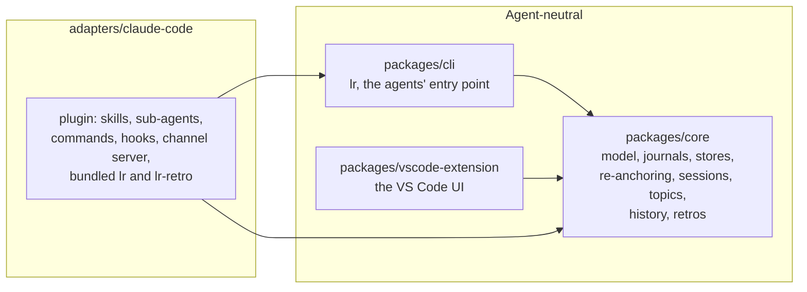
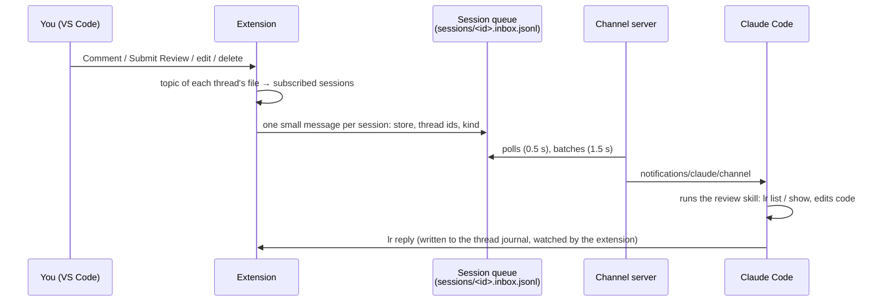

# Architecture

How Local Review works, for maintainers and contributors. For using it, see the [README](../README.md).

## Overview

Local Review has one rule: **everything specific to an agent lives in an adapter**. The storage, the command line and the VS Code extension are agent-neutral; Claude Code is plugged in through `adapters/claude-code`. Another agent (e.g. Codex) would come as another adapter, on the same storage, command line and session registry.



| Folder                      | Purpose                                                                                                                           | May depend on |
| --------------------------- | --------------------------------------------------------------------------------------------------------------------------------- | ------------- |
| `packages/core`             | Data model, append-only journals, stores, re-anchoring, session registry, topics and routing, history, retros. No VS Code import. | nothing       |
| `packages/cli`              | `lr`: what agents run to read and answer threads, read a project's history, run a retro, and subscribe.                           | `core`        |
| `packages/vscode-extension` | Comment threads in the editor, reviews, diffs, deliveries to agent sessions.                                                      | `core`        |
| `adapters/claude-code`      | The Claude Code plugin (skills, sub-agents, commands, hooks, channel server) and their TypeScript sources.                        | `core`, `cli` |

`scripts/check-boundaries.mjs` (run by `npm test`) fails when a package imports what it must not.

## Storage

Everything is plain files. There is no database and no server.

### A project's store: `<root>/.local-review/`

The root is the git top level of an open folder (or the folder itself outside git).

```text
.local-review/
  schema-version            the format version (2)
  threads/<thread-id>.jsonl one append-only journal per thread
  reviews/<review-id>.jsonl one append-only journal per review
  retros/<retro-id>.jsonl   one append-only journal per retro (see "Retros")
  retros/preferences.jsonl  the user's retro preferences (append-only)
  retros/<retro-id>/        what a retro wrote for its agents (regenerated)
  config.json               the project's own settings (the sources of its retros), before the machine's
  saved/<slot>/             threads saved from a git worktree before its removal (see below)
```

A thread journal is a list of events: `thread.created` (with its anchor and branch), `comment.added`, `comment.edited`, `comment.deleted`, `status.changed`, `anchor.updated`, `branch.changed`, `thread.deleted`, `thread.archived`, `thread.unarchived`. The state of a thread is the fold of its events (`core/src/fold.ts`). Appending is atomic enough for several writers (the editor and agents), a line cut by a crash is ignored, and nothing is ever rewritten: deleting a thread is an event too. `thread.deleted` carries an optional `reason`: `user` (the user deleted the thread, or its last comment) or `branch-gone` (the editor deleted it because its git branch was deleted). It is an optional field, so the format version is unchanged; journals written before have none (the history says "reason unknown", except when the last comment was deleted in the same write, which can only be the user). In the same way, an agent's `comment.added` carries an optional `session`: `{ id, message? }`, the agent's conversation it was written in (see "The link to the agent's conversation").

**Format versions.** Each event says in `v` which format it needs, and `schema-version` the newest format the store was written with. Version 2 added the two archive events (written by the user only): they carry `v: 2`, while every other event keeps `v: 1`, so that an older version still reads and changes every thread that was never archived. An older version that meets an archived thread skips the events it does not know, shows the thread read-only, and says to update Local Review (the same as for any newer format). Migrating a store from version 1 changes no journal (a version 1 journal is a valid version 2 journal): the first write of this version records `2` in `schema-version` (written aside, then renamed), and a newer number is never lowered.

**Archived threads** (`Store.archiveThread`, `unarchiveThread`) are finished threads kept out of the way: `loadAll` (what the editor shows), `agentView` (what `lr list` and `lr show` give agents) and every write but unarchiving skip them, while the history keeps them, with `archivedAt` (archiving is not activity: a thread's period does not change). `Store.purgeThread` deletes a journal for good, the only removal of a file in the store: by a purge, or by a deletion when the history is not kept (see "Keep history").

A review journal holds `review.started`, `review.branch.changed`, then `review.submitted` or `review.discarded`. A review is about a branch, or, for files not tracked by git (outside git, or ignored), about a folder: the direct parent of the files (`path`, relative to the root). There is at most one review in progress per branch, and per folder. A draft is a comment whose `reviewId` is a review in progress. Reviews started off any branch by earlier versions have no folder: they cover no file, and can still be submitted or discarded.

A thread's **anchor** records its file (relative to the root), the version it is about (working tree, index, `HEAD` or a commit, and which side of a diff), its line range, the commented code and a few lines of context. Re-anchoring (`core/src/reanchor.ts`) finds the code again after changes: exact match, moved, then whitespace-insensitive; otherwise the thread is outdated.

A thread's **branch** (`repo`, `branch`) is the branch of its file when it was created: `repo` is the git common directory, shared by all the worktrees of a repository.

### A project's history

`lr history` (`projectHistory` in `core/src/project.ts`) reads every store of a **project**: a folder, its subfolders (hidden folders, dependencies, build outputs and the macOS `Library` and `Applications` folders skipped), and the git worktrees of the repositories found there (`git worktree list`), even outside the folder. When the folder itself has no store, the closest one above it counts too, as for the other `lr` commands. Each store is read once (by its real path). There is no index: finding the stores and folding a few hundred threads takes well under a second.

A thread's history (`threadHistory` in `core/src/history.ts`) is a second fold of its journal, next to `foldThread`: it keeps everything published, in order (comments with their edits and deletions, status changes, the thread's deletion), and leaves out the drafts of reviews in progress or discarded, as well as what was deleted or reworded while still a draft of a review submitted later. A thread is active in a period when something was published in it then; moving its code is not activity.

### Archive and clean-up

`core/src/archive.ts` manages the threads of one or more projects (`projectThreads`: the history's threads, each once, with every store holding its journal), for `lr archive`, `lr unarchive`, `lr purge` and the extension's commands alike:

- `resolvedBefore`: the resolved threads, not archived yet, resolved before a date; `archivedThreads`: the archived ones;
- a thread holding a draft reply of the user's review in progress is neither archived (`Store.archiveThread` refuses: the reply would be published out of sight) nor purged (the draft would be lost): `hasDrafts` in its history;
- `purgePlan`: the **finished** threads (resolved, archived or deleted) where nothing was published since a date, and, apart, those as quiet but still in progress (never purged), and those a retro has not read yet (`retroReading` in `core/src/cadence.ts`, for the projects that had a retro: the threads active after the end of the last finished retro, and those of a retro started and not finished; `null` when no project had one, and then nothing is kept for retros);
- `archiveThreads` and `unarchiveThreads` write where the thread lives (a copy saved from a worktree keeps the state of when it was saved, unless the thread is left only there); `purgeThreads` deletes every journal of each thread, saved copies included. Review journals are kept: other threads' drafts depend on them.

A date given as `60d` is shown as the day it means, with the number of days (`dateArgLabel`). `lr purge` without `--yes` only says what would go; `--count <n>` makes the deletion refuse if the number changed since it was announced. With Claude Code, the plugin's hook also makes Claude Code ask the user before `lr purge --yes` runs. The extension computes the plan once, shows its number in the confirmation, and deletes exactly those threads. An export is the history in JSON (`historyJson` in `core/src/historyJson.ts`): `lr history --format json --out <file>`, or one history per project of the open folders from the extension.

### Keep history

The machine setting `keepHistory` (`config.json`, on by default; `lr config set keep-history`, and the extension's `localReview.keepHistory` user setting, mirrored there) says whether what is deleted stays for the history and retros. On, a deletion is an event, and the Claude Code hook saves a worktree's threads before an agent removes it. Off, the editor erases a thread after deleting it (`eraseThread`: its journal, and its copies saved from worktrees; on "Delete Thread", the deletion of its last comment, the file gone, and a branch deleted), and the hook only warns Claude. The deletion is still sent to the subscribed sessions; `lr` then says that a thread it cannot find may have been deleted. `historyPlan` and `eraseHistory` (`lr purge --history`, and the extension's offer when the setting is turned off) erase the history already kept: the deleted threads, and the whole `saved/` slots. `lr retro scope` says when the history is not kept, so that the retro announces it.

### Threads saved from git worktrees

`git worktree remove` deletes a linked worktree's folder, and its `.local-review/` with it. `saveWorktreeThreads` (`core/src/worktrees.ts`; `lr worktree save`, the extension's **Save Worktree Threads**, and the Claude Code hook) copies the journals of every store of the worktree (`threads/` and `reviews/`, the latter so that drafts stay drafts) to the store of the repository's **main worktree** (the first of `git worktree list`; none for a bare repository), in `saved/<slot>/`, one slot per store saved (its folder name and a hash of its path). `origin.json` records where they come from: the worktree, the store's folder (anchors are relative to it), the repository, the branch at the last save, and when it was first and last saved. Saving again copies the journals again (they only grow), and never removes anything.

The editor neither reads nor watches `saved/`: the copies are never shown, nor changed when a branch is deleted. The history (`projectStores`) adds the saved stores found in each store of the project, with origin `saved`; a thread found in several stores (its worktree still exists) counts once, from its longest journal (journals only grow), and a saved store whose threads are all still in their worktree is left out. Older versions ignore `saved/`: the format version is unchanged. Creating the main store first adds `.local-review/` to `.git/info/exclude` (`prepareStoreHome`, shared with the retros).

### The machine folder: `~/.local-review/` (or `$LOCAL_REVIEW_HOME`)

```text
~/.local-review/
  config.json                   the settings of this machine (lr config), read by the agent hooks;
                                the extension writes Keep history and the retro settings set in VS Code
  agent-sessions.jsonl          the agent sessions seen (id, folder, start; append-only), for the retro cadence
  files/                        the store of files outside any open folder (rooted at "/")
  sessions/<id>.json            a running agent session
  sessions/<id>.subscriptions.jsonl   what it is subscribed to (append-only)
  sessions/<id>.inbox.jsonl     its message queue (append-only)
  sessions/<id>.note-*          small notes an adapter keeps between two hooks
```

## Retros

A retro looks back at a period of work (the review threads, the agent's sessions, an audit of the setup: the **sources** the user chooses, at least one) and turns it into changes to the agent's setup, decided with the user. The data, the journal, the preferences and the guard rails are agent-neutral (`core`, `lr retro`); the conversation, the sub-agents and the files changed are the agent's (for Claude Code: the `retro` skill, the `retro-classifier`, `retro-threads-analyst`, `retro-sessions-analyst`, `retro-audit-analyst` and `retro-analyst` sub-agents, and `lr-retro`).

```mermaid
sequenceDiagram
  participant U as You
  participant S as Retro session (skill)
  participant L as lr retro
  participant D as Audit (lr-retro audit)
  participant I as Sessions (lr-retro reports or insights)
  participant C as Classifier sub-agent
  participant Q as Source sub-agents (threads, sessions, audit)
  participant A as Analyst sub-agent
  participant P as Applier sub-agent
  S->>L: scope (period since the last retro, stores, size, time, how sessions are read)
  S->>I: lr-retro sessions (the project's sessions in the period; reports to write and their estimate)
  S->>U: feedback on the last retro, then the period to choose
  S->>L: lr retro sources --set (first retro of the project: its settings, yes / no / ask per source)
  S->>U: the sources set to ask (when they have data), then the recap: GO
  S->>L: start --sources (the sources, the period's thread ids, and the sessions mode, are recorded)
  S-)D: in the background, with the audit: /doctor prompt-audit, read-only
  S-)I: in the background, with the sessions, one or the other: a report per session (analytics, then Opus), or /insights
  I->>L: retro.reports and retros/sessions/<session>.json, or retro.sessions and sessions.json
  S->>L: lr-retro usage: retro.usage (how much each skill, command, sub-agent was used)
  S->>C: with the reviews: classify (Jev through lr-retro jev, or itself)
  C->>L: input --for classify, then classification
  D-->>S: audit report (retros/<id>/audit.md)
  par one sub-agent per source read, fresh contexts
    S->>Q: threads, sessions, audit
    Q->>L: input --for threads | sessions | audit, then findings (checked)
  end
  S->>A: weigh the findings (fresh context)
  A->>L: input --for analysis (the findings, the sources' files) + lr-retro setup, then check and propose
  L->>L: guard rails (sessions and moments cited checked, unused tools asked), numbers, check of the last retro's changes
  S->>L: show (overview)
  S->>U: did the last retro's changes help? (their numbers)
  loop each proposal, in the order of the discussion
    S->>L: show --next (always the same parts)
    S->>U: the proposal, then the exact change (a diff)
    U->>S: accept, modify, exclude, change the target (unused tool: remove, keep and fix, keep)
    S->>L: decide
    S-)P: in the background: the exact change validated
    P->>L: applied (files changed)
  end
  S->>L: finish, once every applier is done
```

- **Where**: the store of the project folder when it has one, or when it is outside git; else the store at the top of its git worktree (`retroHome`). Creating that store at the top of a repository adds `.local-review/` to `.git/info/exclude` first. Older versions never read `retros/`, so the store's format version is unchanged; retro events carry their own `v`.
- **The sources** (`core/src/config.ts`): `reviews`, `sessions`, `audit`, each set `yes`, `no` or `ask` (`retroSourceReviews`, `retroSourceSessions`, `retroSourceAudit`, `ask` by default). The project's own settings (`.local-review/config.json` of the retro's home, `readProjectConfig`; `lr retro sources --set`, `lr config --project`) come before the machine's (`config.json`, `lr config`, mirrored from VS Code's `localReview.retroSources.*`); `readSourceSettings` says where each comes from, and whether the project set any (else its first retro asks). The skill turns the settings and the data of the period into the sources of the retro, which `lr retro start --sources` records (`sources` of `retro.started`; older retros read all three). Without the reviews, the retro records no thread. Each step on a source left out is refused (`lr retro input`, `findings`, `classification`) or skipped (`lr-retro audit`, `usage`, `reports`, `insights`; `jev` fails).
- **The journal** (`RetroBook`, `core/src/retro.ts`): `retro.started` (project folder, period, sources, stores, thread ids, preferences in force), `retro.feedback`, `retro.classified` (labels, possibly in several passes), `retro.proposed` (proposals, watch list, what the guard rails left out, the overview of the sessions), `retro.findings` (what one source showed, read by its own agent: the last per source counts), `retro.usage` (how much the setup's tools were used), `retro.sessions` and `retro.reports` (the agent's sessions read, and the reports on them), `retro.decided`, `retro.applied` (files changed), `retro.undone` (a decision recorded by mistake, and its files, forgotten: `lr retro undo`; the journal is never edited), `retro.finished`. The next retro starts just after the `until` of the last finished one of the same folder.
- **The inputs** (`core/src/retroScope.ts`): `lr retro input` writes, in `retros/<id>/`, the threads with their conversation (`threadText`), and, for the analysis, the preferences, the previous retros (decisions, exclusions, watch list) and statistics computed without a model (reopened threads, questions of the agent, back-and-forth, deleted: by the user, or with their branch). Threads saved from a removed worktree are read like the others, their store marked as saved. The agent writes its answer as a JSON file next to it, and records it with one plain `lr` command.
- **The sessions mode** (`retroSessions` of the machine settings, `lr config set retro-sessions reports|insights`, mirrored from VS Code's `localReview.retroSessions`): a retro reads the agent's sessions through a report on each one (`reports`, the default) or through the agent's own summaries (`insights`), never both. `retro.started` records the mode (`sessionsMode`; older retros have none and read whatever was recorded); `lr-retro reports` and `lr-retro insights` skip a retro of the other mode; the inputs and the guard rails only take the sessions of its mode.
- **One source at a time** (`core/src/retroFindings.ts`, `retroScope.ts`): `lr retro input --for threads | sessions | audit` writes the input of one source's agent (the preferences and previous retros, then the threads with the statistics and the changes to check; or the sessions of the mode; or the audit's report with the usage of the tools), ending with the common format of the findings (`findingsFormat`). `lr retro findings <id> --source <s>` checks them (`checkFindings`: one cause each, a confidence, evidence of its own source: threads of the period, sessions the retro reads with words and moments copied from them, or the audit's place and finding; the threads also check the last retro's changes, `verify`, the sessions give the `overview`) and records them (`retro.findings`); nothing is recorded while some are rejected. Once some source has findings, `lr retro input --for analysis` gives the analysis the findings of every source (`arbiterInput`: with the check of the last changes, the statistics, what the usage says of a tool an audit finding names, the overview) and writes each source's input again as a file to go back to; without findings, it gives every source together, as before (`analysisInput`). `lr retro check` and `propose` take `verify` and `overview` from the findings when the analysis leaves them out.
- **The usage of the setup's tools** (`lr-retro usage`, `adapters/claude-code/src/toolUsage.ts`; `core/src/retroUsage.ts`): the skills (named after their folder), commands (`a/b.md` is `a:b`) and sub-agents (the `name` of their front matter) of the project's `.claude/` and of the user's (`setupTools`), and how many times each was typed by the user (`<command-name>`) or called by the agent (`Skill`, `Agent`), in the main conversation and the sub-agents', without a model: the project's tools on the project's sessions, the user's on every session of the machine, the retro's own left out. The windows say how many sessions and since when, and how long Claude Code keeps them (`cleanupPeriodDays`, 30 by default). A proposal from the audit whose file is a tool used 0 times (`toolOfFile`) becomes, by program, a question (`unused`: column "remove", the change is the removal, the audit's fix kept for "keep it and fix it").
- **The guard rails** (`checkProposals`, `core/src/retroGuards.ts`), applied by `lr retro check` and `lr retro propose` whatever the agent: at least 2 threads of the period (a single one goes to the watch list), except for a finding of an audit of the setup (`audit`: its location and what is wrong), which may only remove or rewrite a rule; a "keep" whose rule had to be enforced (cited in `enforcedIn`, or classified as an ignored rule) becomes "improve"; one cause per proposal; a new rule's target is asked unless a thread supports it; a subject excluded earlier (same reference, similar wording, or 2 of its threads) comes back only with 2 new threads, neither proposed nor watched before that. Each proposal's numbers are computed from its threads.
- **The check of the last retro's changes** (`adoptedChanges`, `verifyChanges`, `verdictOf`): the changes adopted at the last finished retro of the same folder (to improve or remove; accepted, modified or retargeted), with their numbers then: the threads they rested on out of the threads that retro read (`before`), the sessions out of the sessions it read (`beforeSessions`, `sessionsRead`). A change is measured on the sources it rested on that have data in the new period (`measurableSources`): the input of each source's agent lists those measurable on it, and that agent names the threads, or the sessions, of the new period with the same cause (`verify`); the analysis gets both. The share before and after, source by source, gives a verdict each: `stopped` (none), `decreased` (a smaller share) or `not-decreased`; the change is judged on the worst. Without any such source (left out, no data, or a change from the audit alone), it is `not-measured`, with no verdict (`measured: []`). A change left unchecked on a measurable source is rejected, and one that did not decrease with 2 threads or sessions or more needs a proposal that revises it (`revisits`). The check is recorded in `retro.proposed` (`verifications`), and `lr retro show` puts it first, next to the user's feedback.
- **The cadence** (`retroCadence`, `core/src/cadence.ts`): the days since the end of the last finished retro of the folder or of a folder above it (`lastRetroCovering`, looking up for `.local-review/retros/`, from the folder and from the same place in the other worktrees of its git repository, whose threads the project shares), else since the first thread or agent session, the size of the threads with activity since then (`projectHistory`, as the next retro would read them), and the agent sessions started since then in the project's folders (`projectAgentSessions`, `core/src/agentSessions.ts`: the log `agent-sessions.jsonl`, written by the agent's adapter). Due when there is at least one thread or session and the days reach `min(days, maxDays)` or the size reaches its threshold (machine settings `retroReminderDays`, `retroReminderSizeKB`, `retroReminderMaxDays`: 7, 1,000 KB, 25 by default). `lr retro cadence` prints it; the extension shows it in the status bar, and the Claude Code `SessionStart` hook has Claude mention it (see below). The root of the file system is no project: no cadence there.
- **The classification**: the labels (one of 14 categories, plus two scores: a project rule missing from the rules files, an existing rule ignored) feed the statistics and the "keep" guard rail. With a key, `lr-retro jev` asks [Jev](https://jevtypesafeai.com/), 4 requests at a time: the only network call of Local Review, in the adapter, never in `core`, `lr` or the extension. The key (`~/.config/local-review/jev-key`, or `$JEV_API_KEY`) is checked without being read by `lr retro key` (owner only, in no repository), and read only by `lr-retro jev`, which never prints it.
- **The presentation** (`lr retro show <id> --next`, or `<proposal>`): one proposal at a time, in the order of the discussion (improve, remove, keep), always in the same parts under a separator, so that the agent shows the user the same thing every time. The agent adds the exact change (a diff of the file, or the whole new file), records the decision, and hands the validated change, word for word, to a sub-agent (`retro-applier`) that applies it in the background, checks it and records the files, while the discussion goes on; changes to the same file are applied one at a time.
- **The audit** (`lr-retro audit`, `adapters/claude-code/src/retroAudit.ts`): Claude Code's `/doctor prompt-audit` (2.1.283 or later), run by the retro in the background during the classification, in a separate `claude -p`, with Opus, in the project folder, read-only (`--disallowedTools Bash Edit Write NotebookEdit`) and allowed to read the user's `~/.claude` (`--add-dir`). Its report goes to `retros/<id>/audit.md` and to the analysis, which turns its findings into "remove" or "improve" proposals. Skipped when Claude Code is older; stopped after 15 minutes.
- **The agent's sessions** (`lr-retro sessions` and `lr-retro insights`, `adapters/claude-code/src/retroInsights.ts`; `core/src/retroSessions.ts`): `lr-retro sessions` counts the Claude Code sessions of the project in the period for the scope, from Claude Code's own conversations (`projects/*/<session>.jsonl`: the first `cwd` and `timestamp`; sub-agents apart; those run by a program, `"entrypoint": "sdk-cli"`, left out: the retro's own audit and `/insights` among them, which the next retro would otherwise read back, and `lr-retro insights` leaves them out too). `lr-retro insights`, in the background next to the audit, runs `claude -p /insights` (which brings its cache up to date, incrementally), then reads its cache, `usage-data/session-meta/<id>.json` (facts counted without a model, every session of the machine) and `usage-data/facets/<id>.json` (a summary written by a model, for the longer sessions). It keeps the sessions **of the project** (started in the project folder, a folder below, or a git worktree of its repositories: `projectFolders`) **and of the period**; the report (`report.html`), which mixes every project, is never read. These files are internal to Claude Code: the reader depends on three fields of the facts only (`session_id`, `project_path`, `start_time`); when some files are read by no known format, Haiku (`claude -p --model haiku`, no tools) is given the fields' names and the shapes of their values (never the values); its answer is kept as a new format in `$LOCAL_REVIEW_HOME/insights-fields.json` when it reads some of those files, and that format is read without a model from then on. The cache may mix formats (it keeps the summaries of older versions): each file is read with the first format that reads it. Facts files that none of this reads make it fail, for the user to report. The sessions kept go to `retros/<id>/sessions.json` (agent-neutral: `RetroSession`), and their list, with what `/insights` cost and took, to the journal (`retro.sessions`): the analysis input includes them, the guard rails check that a session cited is in that list and that its excerpt is words of its summary (else the summary's own words are shown), and `lr retro finish` says what reading them cost, an equivalent at the API list price. A proposal counts its sessions as evidence (at least 2 threads or sessions); one on sessions only is marked `sessionsOnly`.
- **The reports on the agent's sessions** (`lr-retro reports`, `adapters/claude-code/src/sessionAnalytics.ts`, `sessionTranscript.ts`, `sessionReports.ts`; `core/src/sessionReports.ts`): in the background next to the audit, for each Claude Code session of the project and of the period (`projectTranscripts`) with at least one prompt typed by the user, except the retro's own (the registered session among the command's parent processes, or any that mentions the retro id). First the **analytics**, without a model (`analyseSession`): the session's conversation and its sub-agents' (`<session>/subagents/**/agent-<id>.jsonl`, linked by `agent-<id>.meta.json`; Workflow agents under `workflows/`), read tolerantly (unknown fields ignored, unreadable lines skipped), give metadata (folder, branches, versions, models, tokens, instructions loaded, skills available and never called) and signals in six families (collaboration, tools, setup, workflow, cost, delivery), each occurrence pointing at a moment: agent, `uuid`, time, line. A file changed by one of the agent's commands is not a user edit; git commands are recognised in Bash commands; repeated failures are grouped without their setup steps (`cd`, `source`, `nvm use`…); a pull request linked again and again counts once. Then the **report**: a separate `claude -p` with Opus (`--safe-mode`: none of the user's rules, skills, plugins or hooks; `--tools Read,Grep`; `--no-session-persistence`: it leaves no session of its own), in a temporary folder that holds the analytics and the conversations rendered one step per line (`L<line> <uuid> …`, long texts cut, secrets masked); reads outside that folder are refused. It answers with a JSON report (the brief: `sessionReportBrief.ts`), 4 at a time. Every `uuid` it cites is checked against the session's records: unknown ones are removed and counted (`checks`); secrets it quotes are masked. The report (`SessionReport`: the model's `analysis` and the `analytics`, agent-neutral for `core`) goes to `retros/sessions/<session>.json`, kept by project and untouched by Keep history; it is written again only when the session has more lines than it covers (a failed rewrite keeps the older one). The list (`analysed`, `reused`, `failed`), with the cost, time and tokens, goes to the journal (`retro.reports`). The analysis input includes the reports (signals judged not relevant left out); a proposal may cite a report's words and moments (`sessions[].moments`), checked against the moments the report knows; the analyst reconciles reports and `/insights`, and writes the **overview** of the sessions (`overview`: patterns, frictions, rituals, on sessions the retro reads), recorded in `retro.proposed` and shown by `lr retro show`. `lr-retro sessions` estimates the time and cost of the reports to write from the sessions' sizes (prompts typed), scaled by the reports already written in the project, for the proposed period and for each period to choose from (`RetroScope.options`, listed at every retro: since the last retro or the last 7 days, the last 30 days, the whole history; those that read the last retro's threads again are marked); `lr retro finish` says what they took.
- **The agent's conversations** (`lr-retro conversation`, see below): for an ambiguous thread whose replies are linked to a conversation, the analyst reads it back; `retro.conversation` records whether it was still available, and `lr retro show` lists them.
- **The setup** (`lr-retro setup`, `adapters/claude-code/src/retroSetup.ts`): the rules files (`CLAUDE.md` of the folder, its parents and repositories, `CLAUDE.local.md`, `~/.claude/CLAUDE.md`), then the `.claude/` and `.agents/` folders of the project and of the user (`$CLAUDE_CONFIG_DIR` when set): rules, skills, commands, sub-agents, and only the `hooks` of the settings files (the rest may hold secrets). Rules and hooks are given in full; skills, commands and sub-agents too until about 100 KB, then by their header only.

## Agent sessions

### Registration

An adapter registers each agent session (`SessionRegistry` in `core/src/sessions.ts`): id, agent name, folder, branch, process id, and whether messages reach it on their own (`push`). A session whose process is gone is dropped at the next read. For Claude Code, the `SessionStart` and `SessionEnd` hooks do it; `lr session register | unregister` exists for other adapters.

### Topics and subscriptions

A **topic** (`core/src/topics.ts`) is a branch of a repository, or a path outside git (files ignored by git count as outside git: they do not change with the branch). A session subscribes to topics, with a reason kept for debugging: `launch` (started in a worktree), `modified` (it modified a file there), `user` (asked by the user). `subscribersOf` returns every session subscribed to the topic of a file: the extension publishes to all of them and never picks between them.

### Publishing a comment



The message only points at threads; the agent always reads their current content with `lr`, so it never works on a stale copy. The queue has **one consumer**, the channel server, which acknowledges by advancing a cursor. Claude Code hands a channel message to Claude between two of its steps, even while it works.

### The link to the agent's conversation

`lr reply` records, on the agent's `comment.added`, the session it runs in (`--session`, `$LR_SESSION`, or the registered session among its parent processes) and, when known, the message that runs it (`--message`, or the call its adapter noted: `SessionRegistry.startCall`, picked by `callFor`, the latest recent call naming the thread). It is a best effort: a reply never fails for want of it. `lr history` shows it, and the analysis input of a retro marks the threads whose conversation is linked. Reading a conversation is the adapter's business: `core` and `lr` only keep the ids.

For Claude Code, the session id is Claude Code's own, and the message is the id of the tool call that ran `lr reply`: the `PreToolUse` hook notes it (`call-<id>` note of the session, removed by `PostToolUse`, or `PostToolUseFailure` when the command failed, and with the session). `lr-retro conversation` (`adapters/claude-code/src/retroConversation.ts`) finds the transcript (`<claude dir>/projects/*/<session>.jsonl`, sub-agents' ones included), locates the reply (its tool call, else the latest `lr` command naming the thread), and prints the prompt of that turn, the steps up to the reply and right after it (texts, tool calls and the start of their results), the skill in use and the tokens, within about 12,000 characters shared by the replies of the thread. Transcripts are an internal format of Claude Code, read nowhere else; Claude Code deletes them after `cleanupPeriodDays` (30 days by default), and then the retro says so and does without.

`lr reply --rev <version>` guards against races: a thread's version (`AgentThreadView.rev`) changes only when the user publishes, edits or deletes a comment in it, and a reply to an older version is refused (exit code 3).

## The Claude Code adapter

`adapters/claude-code/plugin` is what Claude Code installs (from the marketplace in `.claude-plugin/marketplace.json`):

| Part                                              | Role                                                                                                                                                                                                                                                                                                                                                                                                                                                                                                                                                                                                        |
| ------------------------------------------------- | ----------------------------------------------------------------------------------------------------------------------------------------------------------------------------------------------------------------------------------------------------------------------------------------------------------------------------------------------------------------------------------------------------------------------------------------------------------------------------------------------------------------------------------------------------------------------------------------------------------- |
| `skills/review/SKILL.md`                          | How Claude handles a review: read, act, reply with `--rev`, subscriptions, special cases, the history.                                                                                                                                                                                                                                                                                                                                                                                                                                                                                                      |
| `skills/retro/SKILL.md`, `agents/retro-*.md`      | `/local-review:retro`: the retro's conversation, and its sub-agents (classification with Haiku; one reading per source, threads, sessions and audit, then the analysis that weighs them, with Opus; application with Sonnet).                                                                                                                                                                                                                                                                                                                                                                               |
| `commands/subscribe.md`, `unsubscribe.md`         | `/local-review:subscribe` and `/local-review:unsubscribe`.                                                                                                                                                                                                                                                                                                                                                                                                                                                                                                                                                  |
| `hooks/hooks.json` → `hooks/local-review-hook.js` | `SessionStart` (register, subscribe to the worktree of launch), `PreToolUse`/`PostToolUse` (subscribe on file changes, including shell commands via `git status`), `SessionEnd`. A new subscription is told to Claude (`additionalContext`). `PreToolUse` also saves the threads of a git worktree about to be removed (see below), and notes the tool call running `lr reply`. Before `lr purge … --yes` (and `lr purge --history --yes`) it answers `permissionDecision: "ask"`: Claude Code asks the user to allow the deletion, whatever its permission rules (in `claude -p`, the command is refused). |
| `.mcp.json` → `channel/local-review-channel.js`   | The channel server: a minimal MCP server over stdio (no SDK), serving the session of the Claude Code process that started it.                                                                                                                                                                                                                                                                                                                                                                                                                                                                               |
| `bin/lr`                                          | The bundled command line, on Claude's `PATH`.                                                                                                                                                                                                                                                                                                                                                                                                                                                                                                                                                               |
| `bin/lr-retro`                                    | What is Claude Code's in a retro: its setup files (`setup`), the classification by Jev (`jev`), the audit of the setup (`audit`), and the conversation of a thread's replies (`conversation`).                                                                                                                                                                                                                                                                                                                                                                                                              |

The bundles are built by `adapters/claude-code/build.mjs` and **committed**, because Claude Code installs plugins from git. `scripts/check-plugin-bundle.mjs` (run by `npm test`) rebuilds them elsewhere and fails when the committed ones are stale.

**Before a worktree is removed**: `PreToolUse` runs before the tool, and Claude Code waits for it. On `Bash`, the hook reads the command (`worktreeRemovals` in `adapters/claude-code/src/hook.ts`, a best effort: simple commands split on `&&`, `;`, `|`…, quotes, `cd`, `git -C`; not globs nor variables) for `git worktree remove <path>` (a path, or the end of a worktree's path, as git allows) and `rm -r <path>` of a worktree's top folder; on `ExitWorktree` with `action: "remove"`, the session's own worktree. For each linked worktree found, it saves its threads, unless `keepHistory` is off in the machine settings (`config.json`, on by default); then it only tells Claude that they will be lost. The hook never blocks the command.

**The retro reminder**: on `SessionStart` of a new conversation (`source` other than `resume` and `compact`), when the `retroReminder` machine setting is on, the hook measures the cadence of the session's folder and, when a retro is due, asks Claude (`additionalContext`) to say so once in its first reply and suggest `/local-review:retro`, without starting it. The measure is given up after 3 seconds, and any failure is silent: a session never waits for it. Before it, the hook records the session in the log of agent sessions (`recordClaudeSession`, `adapters/claude-code/src/sessionLog.ts`), unless Claude Code runs for a program (`-p` or `--print` on its command line); the first time for a Claude Code folder (`$CLAUDE_CONFIG_DIR` or `~/.claude`), it records every conversation that folder keeps too, but those run by a program (`"entrypoint": "sdk-cli"`), and marks the folder as imported. That too is given up after 3 seconds (the import is tried again next time).

Whether a session was launched with the channel cannot be asked to Claude Code: the `SessionStart` hook reads the command line of the `claude` process instead. `lr` finds the session it runs in by walking up its parent processes to a registered process id.

## The VS Code extension

- `controller.ts`: the comment controller: creating, replying, editing, reviews (one per branch; off any branch, one per folder), re-anchoring as documents change, git versions and aliases, rename following, branch tracking (threads of other branches are kept but hidden; anchors are never written from another branch's content).
- `deliveries.ts`: publishing to subscribed sessions, the "nobody is subscribed" prompt, `pushToAgents`.
- `branches.ts`: which branch is checked out where (polled every 2 s).
- `sessions.ts`, `agentReplies.ts`, `review.ts`: the status bar items and their menus.
- `retroReminder.ts` (texts in `retroStatus.ts`, without `vscode`): the retro reminder in the status bar, measured for each workspace folder at start, every 2 minutes, 10 seconds after comments change and when the window gets the focus back; the folder most due is shown. The `localReview.retroReminder.*` settings set in VS Code win over the machine settings, and the user-level ones are written to `config.json` when they change (and at start when not mirrored yet), for the agent hooks.
- `history.ts`: the `localReview.keepHistory` user setting, mirrored in `config.json` (at start and when it changes; reset: back to on), and, when turned off, the offer to erase the history kept in the open folders. The controller reads it (`keepHistory()`: the VS Code value, else the machine one) to erase the threads it deletes.
- `roots.ts`: stores of the open folders, plus the machine store as the last resort.
- `archive.ts`: **Archive Resolved Threads…**, **Show Archived Threads** (pick the ones to unarchive), **Export Threads (JSON)…** and **Delete Old Threads Permanently…**, on the projects of the open folders and the machine store, through `core/src/archive.ts`; **Archive Thread** is in the thread header (`controller.ts`). Their prompts are replaceable for the integration tests. Threads archived, unarchived or deleted outside the editor (by `lr`) come and go through the watcher.
- Worktrees (`controller.ts`): the first time an open linked git worktree has comments (at load, or on a new comment), a message says that removing it deletes them, with **Save Threads Now**; each worktree is warned once (remembered in the extension's global state). **Save Worktree Threads** saves the open worktree (or one picked among them). A branch deleted while VS Code runs deletes its threads with the reason `branch-gone`.
- `watcher.ts`: stores are watched for writes by agents, with Node's watcher (VS Code's misses some writes of other processes on Linux). A store that does not exist yet, or was removed, is waited for from its parent folder.
