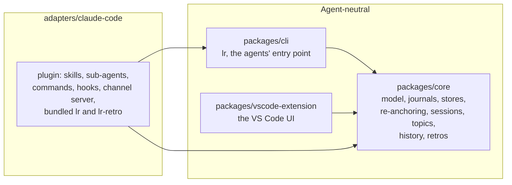
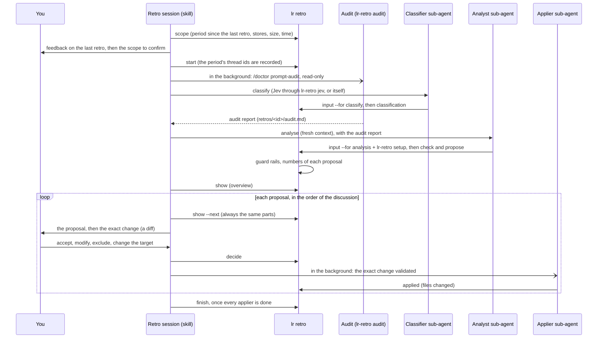
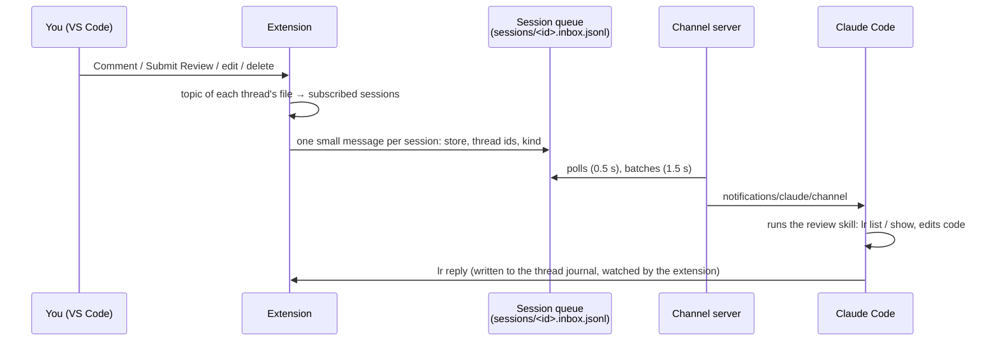

# Architecture

How Local Review works, for maintainers and contributors. For using it, see the [README](../README.md).

## Overview

Local Review has one rule: **everything specific to an agent lives in an adapter**. The storage, the command line and the VS Code extension are agent-neutral; Claude Code is plugged in through `adapters/claude-code`. Another agent (e.g. Codex) would come as another adapter, on the same storage, command line and session registry.



| Folder                      | Purpose                                                                                                                           | May depend on |
| --------------------------- | --------------------------------------------------------------------------------------------------------------------------------- | ------------- |
| `packages/core`             | Data model, append-only journals, stores, re-anchoring, session registry, topics and routing, history, retros. No VS Code import. | nothing       |
| `packages/cli`              | `lr`: what agents run to read and answer threads, read a project's history, run a retro, and subscribe.                           | `core`        |
| `packages/vscode-extension` | Comment threads in the editor, reviews, diffs, deliveries to agent sessions.                                                      | `core`        |
| `adapters/claude-code`      | The Claude Code plugin (skills, sub-agents, commands, hooks, channel server) and their TypeScript sources.                        | `core`, `cli` |

`scripts/check-boundaries.mjs` (run by `npm test`) fails when a package imports what it must not.

## Storage

Everything is plain files. There is no database and no server.

### A project's store: `<root>/.local-review/`

The root is the git top level of an open folder (or the folder itself outside git).

```text
.local-review/
  schema-version            the format version (1)
  threads/<thread-id>.jsonl one append-only journal per thread
  reviews/<review-id>.jsonl one append-only journal per review
  retros/<retro-id>.jsonl   one append-only journal per retro (see "Retros")
  retros/preferences.jsonl  the user's retro preferences (append-only)
  retros/<retro-id>/        what a retro wrote for its agents (regenerated)
```

A thread journal is a list of events: `thread.created` (with its anchor and branch), `comment.added`, `comment.edited`, `comment.deleted`, `status.changed`, `anchor.updated`, `branch.changed`, `thread.deleted`. The state of a thread is the fold of its events (`core/src/fold.ts`). Appending is atomic enough for several writers (the editor and agents), a line cut by a crash is ignored, and nothing is ever rewritten: deleting a thread is an event too.

A review journal holds `review.started`, `review.branch.changed`, then `review.submitted` or `review.discarded`. A review is about a branch, or, for files not tracked by git (outside git, or ignored), about a folder: the direct parent of the files (`path`, relative to the root). There is at most one review in progress per branch, and per folder. A draft is a comment whose `reviewId` is a review in progress. Reviews started off any branch by earlier versions have no folder: they cover no file, and can still be submitted or discarded.

A thread's **anchor** records its file (relative to the root), the version it is about (working tree, index, `HEAD` or a commit, and which side of a diff), its line range, the commented code and a few lines of context. Re-anchoring (`core/src/reanchor.ts`) finds the code again after changes: exact match, moved, then whitespace-insensitive; otherwise the thread is outdated.

A thread's **branch** (`repo`, `branch`) is the branch of its file when it was created: `repo` is the git common directory, shared by all the worktrees of a repository.

### A project's history

`lr history` (`projectHistory` in `core/src/project.ts`) reads every store of a **project**: a folder, its subfolders (hidden folders, dependencies, build outputs and the macOS `Library` and `Applications` folders skipped), and the git worktrees of the repositories found there (`git worktree list`), even outside the folder. When the folder itself has no store, the closest one above it counts too, as for the other `lr` commands. Each store is read once (by its real path). There is no index: finding the stores and folding a few hundred threads takes well under a second.

A thread's history (`threadHistory` in `core/src/history.ts`) is a second fold of its journal, next to `foldThread`: it keeps everything published, in order (comments with their edits and deletions, status changes, the thread's deletion), and leaves out the drafts of reviews in progress or discarded, as well as what was deleted or reworded while still a draft of a review submitted later. A thread is active in a period when something was published in it then; moving its code is not activity.

### The machine folder: `~/.local-review/` (or `$LOCAL_REVIEW_HOME`)

```text
~/.local-review/
  files/                        the store of files outside any open folder (rooted at "/")
  sessions/<id>.json            a running agent session
  sessions/<id>.subscriptions.jsonl   what it is subscribed to (append-only)
  sessions/<id>.inbox.jsonl     its message queue (append-only)
  sessions/<id>.note-*          small notes an adapter keeps between two hooks
```

## Retros

A retro looks back at the review feedback of a period and turns it into changes to the agent's setup, decided with the user. The data, the journal, the preferences and the guard rails are agent-neutral (`core`, `lr retro`); the conversation, the sub-agents and the files changed are the agent's (for Claude Code: the `retro` skill, the `retro-classifier` and `retro-analyst` sub-agents, and `lr-retro`).



- **Where**: the store of the project folder when it has one, or when it is outside git; else the store at the top of its git worktree (`retroHome`). Creating that store at the top of a repository adds `.local-review/` to `.git/info/exclude` first. Older versions never read `retros/`, so the store's format version is unchanged; retro events carry their own `v`.
- **The journal** (`RetroBook`, `core/src/retro.ts`): `retro.started` (project folder, period, stores, thread ids, preferences in force), `retro.feedback`, `retro.classified` (labels, possibly in several passes), `retro.proposed` (proposals, watch list, what the guard rails left out), `retro.decided`, `retro.applied` (files changed), `retro.undone` (a decision recorded by mistake, and its files, forgotten: `lr retro undo`; the journal is never edited), `retro.finished`. The next retro starts just after the `until` of the last finished one of the same folder.
- **The inputs** (`core/src/retroScope.ts`): `lr retro input` writes, in `retros/<id>/`, the threads with their conversation (`threadText`), and, for the analysis, the preferences, the previous retros (decisions, exclusions, watch list) and statistics computed without a model (reopened threads, questions of the agent, back-and-forth, deleted). The agent writes its answer as a JSON file next to it, and records it with one plain `lr` command.
- **The guard rails** (`checkProposals`, `core/src/retroGuards.ts`), applied by `lr retro check` and `lr retro propose` whatever the agent: at least 2 threads of the period (a single one goes to the watch list), except for a finding of an audit of the setup (`audit`: its location and what is wrong), which may only remove or rewrite a rule; a "keep" whose rule had to be enforced (cited in `enforcedIn`, or classified as an ignored rule) becomes "improve"; one cause per proposal; a new rule's target is asked unless a thread supports it; a subject excluded earlier (same reference, similar wording, or 2 of its threads) comes back only with 2 new threads, neither proposed nor watched before that. Each proposal's numbers are computed from its threads.
- **The classification**: the labels (one of 14 categories, plus two scores: a project rule missing from the rules files, an existing rule ignored) feed the statistics and the "keep" guard rail. With a key, `lr-retro jev` asks [Jev](https://jevtypesafeai.com/), 4 requests at a time: the only network call of Local Review, in the adapter, never in `core`, `lr` or the extension. The key (`~/.config/local-review/jev-key`, or `$JEV_API_KEY`) is checked without being read by `lr retro key` (owner only, in no repository), and read only by `lr-retro jev`, which never prints it.
- **The presentation** (`lr retro show <id> --next`, or `<proposal>`): one proposal at a time, in the order of the discussion (improve, remove, keep), always in the same parts under a separator, so that the agent shows the user the same thing every time. The agent adds the exact change (a diff of the file, or the whole new file), records the decision, and hands the validated change, word for word, to a sub-agent (`retro-applier`) that applies it in the background, checks it and records the files, while the discussion goes on; changes to the same file are applied one at a time.
- **The audit** (`lr-retro audit`, `adapters/claude-code/src/retroAudit.ts`): Claude Code's `/doctor prompt-audit` (2.1.283 or later), run by the retro in the background during the classification, in a separate `claude -p`, with Opus, in the project folder, read-only (`--disallowedTools Bash Edit Write NotebookEdit`) and allowed to read the user's `~/.claude` (`--add-dir`). Its report goes to `retros/<id>/audit.md` and to the analysis, which turns its findings into "remove" or "improve" proposals. Skipped when Claude Code is older; stopped after 15 minutes.
- **The setup** (`lr-retro setup`, `adapters/claude-code/src/retroSetup.ts`): the rules files (`CLAUDE.md` of the folder, its parents and repositories, `CLAUDE.local.md`, `~/.claude/CLAUDE.md`), then the `.claude/` and `.agents/` folders of the project and of the user (`$CLAUDE_CONFIG_DIR` when set): rules, skills, commands, sub-agents, and only the `hooks` of the settings files (the rest may hold secrets). Rules and hooks are given in full; skills, commands and sub-agents too until about 100 KB, then by their header only.

## Agent sessions

### Registration

An adapter registers each agent session (`SessionRegistry` in `core/src/sessions.ts`): id, agent name, folder, branch, process id, and whether messages reach it on their own (`push`). A session whose process is gone is dropped at the next read. For Claude Code, the `SessionStart` and `SessionEnd` hooks do it; `lr session register | unregister` exists for other adapters.

### Topics and subscriptions

A **topic** (`core/src/topics.ts`) is a branch of a repository, or a path outside git (files ignored by git count as outside git: they do not change with the branch). A session subscribes to topics, with a reason kept for debugging: `launch` (started in a worktree), `modified` (it modified a file there), `user` (asked by the user). `subscribersOf` returns every session subscribed to the topic of a file: the extension publishes to all of them and never picks between them.

### Publishing a comment



The message only points at threads; the agent always reads their current content with `lr`, so it never works on a stale copy. The queue has **one consumer**, the channel server, which acknowledges by advancing a cursor. Claude Code hands a channel message to Claude between two of its steps, even while it works.

`lr reply --rev <version>` guards against races: a thread's version (`AgentThreadView.rev`) changes only when the user publishes, edits or deletes a comment in it, and a reply to an older version is refused (exit code 3).

## The Claude Code adapter

`adapters/claude-code/plugin` is what Claude Code installs (from the marketplace in `.claude-plugin/marketplace.json`):

| Part                                              | Role                                                                                                                                                                                                                                         |
| ------------------------------------------------- | -------------------------------------------------------------------------------------------------------------------------------------------------------------------------------------------------------------------------------------------- |
| `skills/review/SKILL.md`                          | How Claude handles a review: read, act, reply with `--rev`, subscriptions, special cases, the history.                                                                                                                                       |
| `skills/retro/SKILL.md`, `agents/retro-*.md`      | `/local-review:retro`: the retro's conversation, and its three sub-agents (classification with Haiku, analysis with Opus, application with Sonnet).                                                                                          |
| `commands/subscribe.md`, `unsubscribe.md`         | `/local-review:subscribe` and `/local-review:unsubscribe`.                                                                                                                                                                                   |
| `hooks/hooks.json` → `hooks/local-review-hook.js` | `SessionStart` (register, subscribe to the worktree of launch), `PreToolUse`/`PostToolUse` (subscribe on file changes, including shell commands via `git status`), `SessionEnd`. A new subscription is told to Claude (`additionalContext`). |
| `.mcp.json` → `channel/local-review-channel.js`   | The channel server: a minimal MCP server over stdio (no SDK), serving the session of the Claude Code process that started it.                                                                                                                |
| `bin/lr`                                          | The bundled command line, on Claude's `PATH`.                                                                                                                                                                                                |
| `bin/lr-retro`                                    | What is Claude Code's in a retro: its setup files (`setup`) and the classification by Jev (`jev`).                                                                                                                                           |

The bundles are built by `adapters/claude-code/build.mjs` and **committed**, because Claude Code installs plugins from git. `scripts/check-plugin-bundle.mjs` (run by `npm test`) rebuilds them elsewhere and fails when the committed ones are stale.

Whether a session was launched with the channel cannot be asked to Claude Code: the `SessionStart` hook reads the command line of the `claude` process instead. `lr` finds the session it runs in by walking up its parent processes to a registered process id.

## The VS Code extension

- `controller.ts`: the comment controller: creating, replying, editing, reviews (one per branch; off any branch, one per folder), re-anchoring as documents change, git versions and aliases, rename following, branch tracking (threads of other branches are kept but hidden; anchors are never written from another branch's content).
- `deliveries.ts`: publishing to subscribed sessions, the "nobody is subscribed" prompt, `pushToAgents`.
- `branches.ts`: which branch is checked out where (polled every 2 s).
- `sessions.ts`, `agentReplies.ts`, `review.ts`: the status bar items and their menus.
- `roots.ts`: stores of the open folders, plus the machine store as the last resort.
- `watcher.ts`: stores are watched for writes by agents, with Node's watcher (VS Code's misses some writes of other processes on Linux). A store that does not exist yet, or was removed, is waited for from its parent folder.
