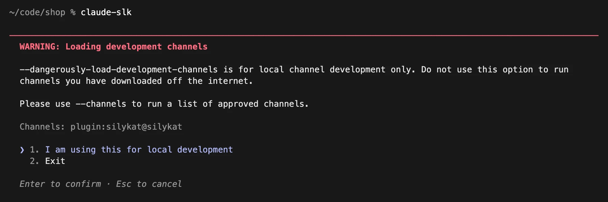

# Install

silykat has two parts: an extension for VS Code, where you comment, and a plugin for Claude Code, so that Claude receives your comments. Install both. It takes a few minutes.

## Requirements

- **VS Code** 1.100 or later.
- **git**.
- **Claude Code** in a terminal, logged in with a claude.ai account (Pro or Max) or a Console API key.

> [!NOTE]
> On a Claude Team or Enterprise plan, an admin must enable channels for your organization. Without them, Claude only sees your comments when you ask. See [Limitations](./limitations.md).

## 1. Install the VS Code extension

1. In VS Code, open the **Extensions** view.
2. Search for **silykat** and click **Install**.

Or, in a terminal:

```sh
code --install-extension silykat.silykat
```

The extension is on the [VS Code Marketplace](https://marketplace.visualstudio.com/items?itemName=silykat.silykat) and on [Open VSX](https://open-vsx.org/extension/silykat/silykat).

## 2. Install the Claude Code plugin

In a terminal, run:

```sh
claude plugin marketplace add silykat/silykat
claude plugin install silykat@silykat
```

## 3. Launch Claude Code with the silykat channel

The channel is what lets your comments reach Claude on their own. Channels are a Claude Code research preview, so the launch command is long. Add an alias to your shell profile (for example `~/.zshrc`):

```sh
alias claude-slk='claude --dangerously-load-development-channels plugin:silykat@silykat'
```

Open a new terminal, then start Claude Code with `claude-slk` instead of `claude`.

At each launch, Claude Code warns you about development channels. Choose **I am using this for local development**.



You are ready: go to the [Quick start](./quick-start.md).

## Update

The extension updates itself from the Marketplace. To update the plugin:

```sh
claude plugin marketplace update silykat
claude plugin update silykat@silykat
```

Then restart your Claude Code sessions.

## Good to know

### Other editors based on VS Code

Cursor, VSCodium and Windsurf install extensions from Open VSX, where silykat is published. They are not tested yet. The editor must be based on VS Code 1.100 or later. The Claude Code plugin does not depend on the editor.

### Install a specific version

Each [release](https://github.com/silykat/silykat/releases) has the extension as a `.vsix` file. In VS Code, run **Extensions: Install from VSIX…** from the Command Palette and pick the file.

### Build from source

You need Node.js 22.12 or later, with npm 11.10 or later, and the `code` command on your PATH (in VS Code, run **Shell Command: Install 'code' command in PATH**).

```sh
git clone https://github.com/silykat/silykat.git
cd silykat
npm install
npm run install-ext
```

Then reload VS Code (**Developer: Reload Window**). To build the `.vsix` without installing it, run `npm run package`: the file is `packages/vscode-extension/dist/silykat.vsix`.
