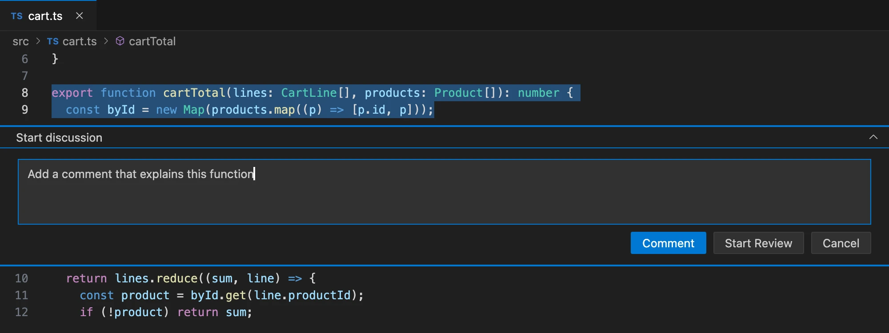
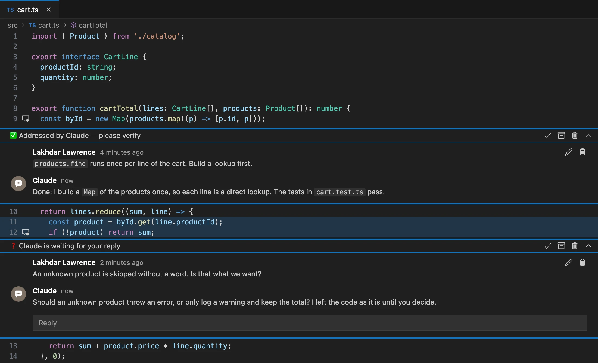

# Quick start

Your first comment, and Claude's first answer, in a few minutes. You need the extension and the plugin [installed](./install.md).

## Your first comment

1. Open a project in VS Code. It should be a git repository.
2. In a terminal, in the same folder, start Claude Code with the channel: `claude-slk` (see [Install](./install.md#3-launch-claude-code-with-the-silykat-channel)). Choose **I am using this for local development**. The VS Code status bar now shows your session, for example **Claude a1b2c3d4**.
3. Tell Claude: `subscribe to this branch`. Claude confirms that it now receives the comments of your branch.
4. In VS Code, open a file and select a few lines.
5. Press **`Ctrl+Cmd+C`** on macOS (**`Ctrl+Alt+C`** on Windows and Linux). You can also right-click and choose **Comment on Selection**.
6. Type a request, for example `Add a comment that explains this function`, then click **Comment**.

Within a few seconds, Claude receives your comment, changes the code and replies in the thread.

The first time, Claude Code asks whether Claude may use the `silykat:review` skill. Allow it, and choose not to be asked again.

## Read the answer

The thread header tells you where things stand:

- **✅ Addressed by Claude**: Claude made the change. Check it.
- **❓ Claude is waiting for your reply**: Claude asks you a question before it changes anything. Answer in the thread.

## Close the thread

1. Check the change in the file.
2. If something is missing, write a reply and click **Reply**: the thread goes back to Claude.
3. When you are satisfied, click **Resolve** (the ✓ in the thread header) to close the thread. It collapses.

Only you resolve threads. Claude never closes one.

That's it. Next, learn to [collect comments in a review](./comments-and-reviews.md#reviews), or see [what Claude does with your comments](./working-with-claude.md).

## If nothing happens

- **VS Code asks "No agent session is subscribed… Publish this comment anyway?"**: Claude is not subscribed to your branch. Click **Cancel**, ask Claude to `subscribe to this branch`, and comment again. Claude also subscribes on its own as soon as it modifies a file of the branch.
- **The status bar shows no Claude session**: check that the plugin is installed (`claude plugin list`) and restart Claude Code.
- **The session shows ⚠**: it was started without the channel. Claude only sees your comments when you type `/silykat:review`. Restart it with `claude-slk`.
