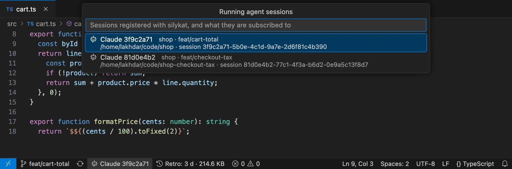

# Working with Claude

When you publish a comment, Claude receives it on its own, changes the code and answers in the thread. This page explains what Claude does, and which Claude sessions get your comments.

## What Claude does with a comment

For each thread, Claude does one of three things:

- **It makes the change** and replies with what it did. The thread shows **✅ Addressed by Claude**: check the change, then click **Resolve** to close the thread.
- **It asks one precise question**, without touching the code. The thread shows **❓ Claude is waiting for your reply**: answer in the thread.
- **It disagrees**, and explains why. Reply to continue the conversation.

At the end, Claude sums up in its session what it did on each thread.

You can also ask Claude to handle your comments at any time: type **`/silykat:review`**.

## Which sessions get your comments

A comment goes to every Claude Code session **subscribed** to its git branch. Outside git, to its file or folder.

A session subscribes on its own:

- when it is **started in a git worktree**: to that worktree's branch;
- when it **modifies a file**: to that file's branch.

You can also ask it: `subscribe to this branch`, `subscribe to this folder`, `unsubscribe`, or `what are you subscribed to?`. The commands `/silykat:subscribe` and `/silykat:unsubscribe` do the same.

Claude tells you whenever a subscription changes. Reading files does not subscribe.

### See your sessions

The status bar shows the Claude sessions of your workspace, each with a short id, for example **Claude a1b2c3d4**. Run **silykat: Show Agent Sessions** to list them all, with what each one is subscribed to.

### Several sessions

You can run several sessions side by side, for example one per git worktree, or a reviewer next to a developer. Each comment goes to the sessions working on its branch. Two sessions on the same branch both get its comments.

### Nobody subscribed

When no session is subscribed to what you publish, VS Code asks first. You can:

- **Cancel**, and ask a session to subscribe;
- **Publish**: the comment is saved, and Claude reads it when you type `/silykat:review`;
- **Publish, Don't Warn Again for This Folder**, until VS Code closes.

## Editing while Claude works

You can edit or delete a published comment at any time, even while Claude is working on it.

- **You edit a comment**: Claude gets the new version between two of its steps, and adapts. If it had already answered, the thread goes back to Claude, and your comment shows **edited after Claude replied**.
- **You delete a thread**: Claude stops working on it. It asks you before undoing anything it already changed.

Claude never answers an outdated version of your comment.

## Without the channel

A session started without the channel (plain `claude`, or the Claude Code panel of VS Code) still gets your comments, but only sees them when you type `/silykat:review`. VS Code tells you once, and marks that session with ⚠ in the status bar.

To start with the channel, use the `claude-slk` alias (see [Install](./install.md#3-launch-claude-code-with-the-silykat-channel)).

To send nothing to any session, turn off the `silykat.pushToAgents` setting.

## Good to know

- **Each reply remembers its conversation.** `slk review history` shows the Claude Code session that wrote each reply. Resume that conversation with `claude --resume <session id>`, from the folder it ran in. Retros use this link too.
- **The first time**, Claude Code asks whether Claude may use the `silykat:review` skill. Allow it, and choose not to be asked again.

## Under the hood

Claude reads and answers the threads with `slk`, the silykat command line that comes with the plugin (see [The slk command line](./cli.md)). `slk` refuses a reply to a thread that changed since Claude read it: that is how Claude never answers an outdated version. For the details, see [the architecture](https://github.com/silykat/silykat/blob/main/docs/architecture.md).
